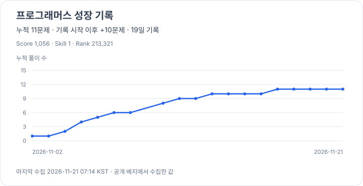

 
<h3>안녕하세요, Java/Spring 백엔드 개발자 권민혁입니다.</h3>
LG 계열사 시스템을 5년간 개발·운영했고, 
지금은 MSA를 공부하고 있습니다. 
<h3>Contact</h3>

Email : <a href="mailto:k509626@gmail.com">k509626@gmail.com</a>

GitHub : <a href="https://github.com/y0y00700">github.com/y0y00700</a>

Portfolio : <a href="https://y0y00700.github.io/">y0y00700.github.io</a>

Blog : <a href="https://k509626.tistory.com">k509626.tistory.com</a>

  

﹏﹏﹏﹏﹏﹏﹏

  

<h3>💻 Tech Stack 💻</h3>
 

<b>Language</b> 

<b>Backend</b> 

<b>Database</b> 

<b>Messaging · Cache</b> 

<b>DevOps</b> 

<b>Test · Monitoring</b> 

 

<!-- PROGRAMMERS:START -->
<h3>🧩 Programmers</h3>

  

  

2026-11-02부터 성장 기록을 쌓고 있습니다 🌱

  <a href="https://github.com/y0y00700/algorithm">문제 풀이 코드</a> ·
  <a href="./data/programmers-history.csv">날짜별 기록</a> ·
  <a href="./docs/programmers.md">갱신 안내</a>

<!-- PROGRAMMERS:END -->

 

