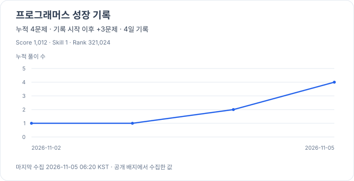

<!--
**y0y00700/y0y00700** is a ✨ _special_ ✨ repository because its `README.md` (this file) appears on your GitHub profile.

Here are some ideas to get you started:

- 🔭 I’m currently working on ...
- 🌱 I’m currently learning ...
- 👯 I’m looking to collaborate on ...
- 🤔 I’m looking for help with ...
- 💬 Ask me about ...
- 📫 How to reach me: ...
- 😄 Pronouns: ...
- ⚡ Fun fact: ...
-->

 
<h3>Welcome to My Repositary 🥳</h3> 
안녕하세요! 웹 개발자 권민혁입니다! 
만나서 반갑습니다 :) 
<h3>Contact</h3>
 
Email : k509626@gmail.com

 
GitHub : https://github.com/y0y00700

 
PortFolio : https://y0y00700.github.io/devportfolio/

 
Vlog : https://k509626.tistory.com

  

﹏﹏﹏﹏﹏﹏﹏

  
 
<h3>💻 Tech Stack 💻</h3>
 
 

 

 

<!-- PROGRAMMERS:START -->
<h3>🧩 Programmers</h3>

  

  

2026-11-02부터 성장 기록을 쌓고 있습니다 🌱

  <a href="https://github.com/y0y00700/algorithm">문제 풀이 코드</a> ·
  <a href="./data/programmers-history.csv">날짜별 기록</a> ·
  <a href="./docs/programmers.md">갱신 안내</a>

<!-- PROGRAMMERS:END -->

 

